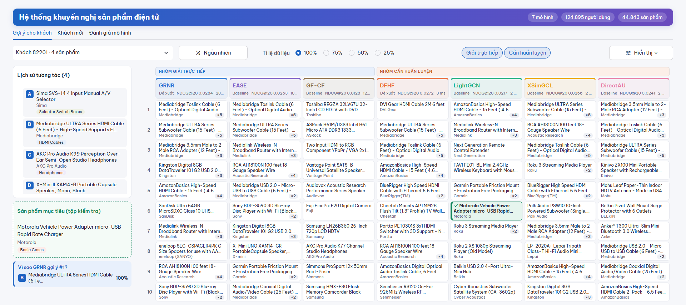

# Electronics Recommender System with Neighborhood Regression and Graph Diffusion

[Tiếng Việt](README.md) · **English** · [Full report (PDF, Vietnamese)](report/main.pdf)

This Advanced Machine Learning project develops two top-K recommenders that score items from user interaction histories. The Amazon Electronics experiments examine trade-offs among ranking quality, model storage, and the amount of training data.

All results below are measured on the **held-out test split**; the validation split is used only to select checkpoints.

- **GRNR** reaches **0.02843 NDCG@20** with all training interactions and a **40.5 MiB** checkpoint. Its difference from full EASE is +0.00034, with a 95% confidence interval from −0.00003 to +0.00072, so the two models are not distinguishable, while the full EASE matrix is about 190 times larger.
- **DFHF** has the highest NDCG@20 among the iteratively trained models at all four retention levels. At 25%, its score of **0.01710** equals **MostPop**, the popularity baseline.

## Run the demo

From the repository root, create a Python 3.11 environment and launch Streamlit. The clone includes the processed data and checkpoints needed to try recommendations. The interface is in Vietnamese.

```bash
conda create -n aml-recsys python=3.11
conda activate aml-recsys
python -m pip install -r requirements.txt
python -m streamlit run app/streamlit_app.py
```

- **Existing users** shows top-10 recommendations and how individual history items contribute to a GRNR score.
- **New users** lets you assemble a history from catalog items and try GRNR, DFHF, EASE top-128, and GF-CF.
- **Model evaluation** shows rankings, charts, statistical tests, and report figures for both comparison groups using results included in the repository.



## Proposed models

| Model | Scoring approach | Baselines |
| --- | --- | --- |
| **GRNR** · Graph-Regularized Neighborhood Regression | Graph-regularized regression on up to 128 neighboring items per target item. Each linear system is solved directly by Cholesky factorization. | Full EASE, EASE top-128, GF-CF |
| **DFHF** · Diffusion-Filtered History Factorization | Aggregates diffusion-filtered item embeddings from the history. Training uses Adam and a catalog softmax with the target item held out of its context. | LightGCN, XSimGCL, DirectAU |

Both models can score a new interaction history without fitting an additional user embedding. See the [GRNR diagram](report/image/grnr_diagram.png) and the [DFHF diagram](report/image/dfhf_diagram.png).

## Dataset and evaluation

The experiments use the Amazon Electronics 5-core subset, treating ratings of at least four stars as positive feedback. The processed dataset contains **124,895 users**, **44,843 items**, and **858,192 training interactions**. [Amazon Product Data](https://cseweb.ucsd.edu/~jmcauley/datasets/amazon/links.html) · [Dataset manifest](data/manifest.json)

- **Chronological split.** For each selected evaluation user, the penultimate interaction goes to validation and the final interaction goes to test. The 80/10/10 ratio applies to the overall interaction counts.
- **Training retention.** All models share the same subsets retaining 25%, 50%, 75%, or 100% of the original training interactions. Sampling uses seed 42 and preserves at least one interaction for each user and item present in the original training split.
- **Model selection and evaluation.** The validation split is used only to select checkpoints by NDCG@20. Configurations and checkpoints are then frozen and scored once on the test split. When scoring test, the validation item is masked from the ranking but not added to the input history, and no model is retrained.
- **Top-K ranking.** On the test split, all models are evaluated on the same 107,087 users with a training history and a target item seen in training. The evaluator ranks all candidate items from the training split, masks the original training history, and reports NDCG and Recall at K = 10 and 20, plus MRR@20.

## Experimental results

The tables show **test NDCG@20**. Columns indicate the fraction of training interactions retained.

### Closed-form models

| Model | 25% | 50% | 75% | 100% |
| --- | ---: | ---: | ---: | ---: |
| **GRNR** | **0.00703** | 0.01291 | 0.02214 | **0.02843** |
| Full EASE | 0.00557 | **0.01432** | **0.02230** | 0.02809 |
| EASE top-128 | 0.00400 | 0.01267 | 0.02033 | 0.02635 |
| GF-CF | 0.00358 | 0.00284 | 0.00560 | 0.01280 |
| MostPop (reference) | 0.01710 | 0.01782 | 0.01778 | 0.01775 |

GRNR scores above EASE top-128 at three of the four retention levels; at 50%, it is not distinguishable from EASE top-128 and scores below full EASE. At 50% and below, the whole group falls under MostPop. At 100%, GRNR takes about 2.5 minutes to fit on CPU. The estimated float32 weight matrix of full EASE is 7.49 GiB, compared with the 40.5 MiB GRNR checkpoint. [Closed-form comparison with MostPop](report/image/H9_mostpop_closed_ndcg20.png)

### Iteratively trained models

| Model | 25% | 50% | 75% | 100% |
| --- | ---: | ---: | ---: | ---: |
| **DFHF** | **0.01710** | **0.01971** | **0.02324** | **0.02724** |
| LightGCN | 0.00786 | 0.01691 | 0.01930 | 0.02168 |
| XSimGCL | 0.01019 | 0.01544 | 0.02158 | 0.02561 |
| DirectAU | 0.00856 | 0.01585 | 0.02065 | 0.02407 |
| MostPop (reference) | 0.01710 | 0.01782 | 0.01778 | 0.01775 |

DFHF scores above all three baselines at every level, with 95% confidence intervals excluding 0. At 25%, DFHF only matches MostPop: for users with a single interaction, it ranks items by their learned item biases, while the three baselines fall below this reference. [Iteratively trained models compared with MostPop](report/image/H9_mostpop_trained_ndcg20.png)

Within-group comparisons are exploratory and use a paired user bootstrap with 10,000 resamples and Holm correction. Results come from one dataset and one seed. Test scores are about a quarter lower than validation scores, but the ordering within each group is largely preserved; validation scores are in `results/val/summary.csv`. Tuning budgets differed across models, and run times were measured on different hardware. [Detailed protocol and results, Chapters 4–6](report/main.pdf)

## Reproduce the experiments

**Fit one GRNR model on CPU** and save the run to a separate directory. The repository includes the processed data. To rebuild it from the raw sources, run `python scripts/prepare_data.py`. The script downloads the data specified in the [shared configuration](configs/common.yaml).

```bash
python scripts/train_model.py --model grnr --density 1.0 --seed 42 --device cpu --results results/reproduction
```

Set `--model` to `dfhf`, `lightgcn`, `xsimgcl`, `directau`, `ease`, or `gfcf` and choose `--density` from `0.25`, `0.5`, `0.75`, and `1.0`. Run each model at all four levels to reproduce both comparison groups. DFHF and the three iterative baselines train for 200 epochs and retain the checkpoint with the highest validation NDCG@20. The original runs used a [GPU notebook](kaggle/kaggle_train.ipynb) for these models and a [CPU notebook](kaggle/kaggle_ease.ipynb) for full EASE because of its dense matrix memory requirements.

Once checkpoints exist at all four levels, score the test split and build the report tables and figures. `evaluate_test.py` first re-scores validation and stops if NDCG@20 differs from `metrics.json`, then scores test from the saved checkpoints without retraining. Full EASE has no saved weight matrix, so the script re-solves it from the training split, which needs about 9 GiB of RAM and 11 minutes per level; add `--ease checkpoint` to use the saved top-128 matrix instead.

```bash
python scripts/evaluate_test.py --device cuda                # writes results/test/
python scripts/make_test_report.py --report-image            # writes reports/test/ and report/image/
```

The validation summary and figures used during model selection are produced by:

```bash
python scripts/summarize_results.py --results results/reproduction
python scripts/make_report.py --results results/reproduction --output results/reproduction/report
```

**Included artifacts.** Git tracks the processed data, checkpoints, training histories, and report figures. The demo loads checkpoints from `results/val/` and displays test-split numbers: `results/test/summary_test.csv`, per-run `metrics.json` files under `results/test/`, and tables B3/B5/B6 in `reports/test/tables/`. Historical GRNR and DFHF checkpoints live under `results/val/sgkr/` and `results/val/sphr/`, respectively.

## Repository layout

| Path | Contents |
| --- | --- |
| [`src/`](src/) · [`configs/`](configs/) | Models, data processing, evaluation, and experiment configurations |
| [`scripts/`](scripts/) · [`kaggle/`](kaggle/) | Training and reporting commands, plus notebooks |
| [`app/`](app/) | Streamlit demo |
| [`data/`](data/) · [`results/`](results/) | Processed data; checkpoints and validation results (`results/val/`), test results (`results/test/`) |
| [`report/`](report/) · [`reports/val/`](reports/val/) · [`reports/test/`](reports/test/) | PDF report, illustrations, and experiment figures |

## References

- **Dataset.** McAuley et al., SIGIR 2015. [Image-Based Recommendations on Styles and Substitutes](https://arxiv.org/abs/1506.04757). He and McAuley, WWW 2016. [Ups and Downs](https://arxiv.org/abs/1602.01585).
- **Closed-form baselines.** Steck, WWW 2019. [EASE](https://arxiv.org/abs/1905.03375). Shen et al., CIKM 2021. [GF-CF](https://arxiv.org/abs/2108.07567).
- **Iterative baselines.** He et al., SIGIR 2020. [LightGCN](https://arxiv.org/abs/2002.02126). Yu et al., IEEE TKDE. [XSimGCL](https://arxiv.org/abs/2209.02544). Wang et al., KDD 2022. [DirectAU](https://arxiv.org/abs/2206.12811).
- **README editing.** Kassis, Agarwal, He, Patel, and Brueckner (2026). [Scientific Agent Skills](https://arxiv.org/abs/2609.00065).
