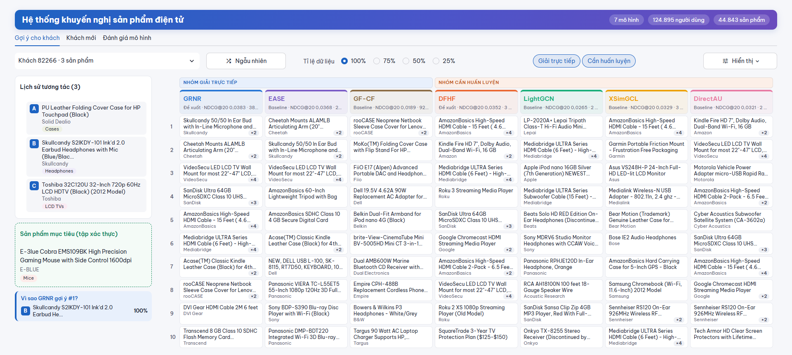

# Electronics Recommender System with Neighborhood Regression and Graph Diffusion

[Tiếng Việt](README.md) · **English** · [Full report (PDF, Vietnamese)](report/main.pdf)

This Advanced Machine Learning project develops two top-K recommenders that score items from user interaction histories. The Amazon Electronics experiments examine trade-offs among ranking quality, model storage, and the amount of training data.

- **GRNR** reaches **0.03829 NDCG@20** with all training interactions and a **40.5 MiB** checkpoint. Its difference from full EASE is +0.00033, with a 95% confidence interval from −0.00007 to +0.00073.
- **DFHF** has the highest NDCG@20 among the iteratively trained models at all four retention levels. At 25%, its score of **0.01766** falls slightly below **MostPop**, the popularity baseline (0.01771).

## Run the demo

From the repository root, create a Python 3.11 environment and launch Streamlit. The clone includes the processed data and checkpoints needed to try recommendations. The interface is in Vietnamese.

```bash
conda create -n aml-recsys python=3.11
conda activate aml-recsys
python -m pip install -r requirements.txt
python -m streamlit run app/streamlit_app.py
```

- **Existing users** shows top-10 recommendations and how individual history items contribute to a GRNR score.
- **New users** lets you assemble a history from catalog items and try GRNR, DFHF, EASE top-128, and GF-CF.
- **Model evaluation** separates the two comparison groups. In a fresh clone, this tab reports a missing summary until the experiment outputs are available.



## Proposed models

| Model | Scoring approach | Baselines |
| --- | --- | --- |
| **GRNR** · Graph-Regularized Neighborhood Regression | Graph-regularized regression on up to 128 neighboring items per target item. Each linear system is solved directly by Cholesky factorization. | Full EASE, EASE top-128, GF-CF |
| **DFHF** · Diffusion-Filtered History Factorization | Aggregates diffusion-filtered item embeddings from the history. Training uses Adam and a catalog softmax with the target item held out of its context. | LightGCN, XSimGCL, DirectAU |

Both models can score a new interaction history without fitting an additional user embedding. See the [GRNR diagram](report/image/grnr_diagram.png) and the [DFHF diagram](report/image/dfhf_diagram.png).

## Dataset and evaluation

The experiments use the Amazon Electronics 5-core subset, treating ratings of at least four stars as positive feedback. The processed dataset contains **124,895 users**, **44,843 items**, and **858,192 training interactions**. [Amazon Product Data](https://cseweb.ucsd.edu/~jmcauley/datasets/amazon/links.html) · [Dataset manifest](data/manifest.json)

- **Chronological split.** For each selected evaluation user, the penultimate interaction goes to validation and the final interaction goes to test. The 80/10/10 ratio applies to the overall interaction counts.
- **Training retention.** All models share the same subsets retaining 25%, 50%, 75%, or 100% of the original training interactions. Sampling uses seed 42 and preserves at least one interaction for each user and item present in the original training split.
- **Top-K ranking.** All models are evaluated on the same 107,215 users with a training history and a validation target seen in training. The evaluator ranks all candidate items from the training split, masks the original training history, and reports NDCG and Recall at K = 10 and 20, plus MRR@20.

## Experimental results

The tables show **validation NDCG@20**. Columns indicate the fraction of training interactions retained.

### Closed-form models

| Model | 25% | 50% | 75% | 100% |
| --- | ---: | ---: | ---: | ---: |
| **GRNR** | **0.00798** | 0.01715 | 0.02928 | **0.03829** |
| Full EASE | 0.00674 | **0.01917** | **0.02939** | 0.03796 |
| EASE top-128 | 0.00497 | 0.01766 | 0.02772 | 0.03679 |
| GF-CF | 0.00385 | 0.00384 | 0.00839 | 0.01886 |

GRNR scores above EASE top-128 at three of the four retention levels and below both EASE variants at 50%. At 100%, GRNR takes about 2.5 minutes to fit on CPU. The estimated float32 weight matrix of full EASE is 7.49 GiB, compared with the 40.5 MiB GRNR checkpoint. [Closed-form comparison with MostPop](report/image/H9_mostpop_closed_ndcg20.png)

### Iteratively trained models

| Model | 25% | 50% | 75% | 100% |
| --- | ---: | ---: | ---: | ---: |
| **DFHF** | **0.01766** | **0.02266** | **0.02901** | **0.03519** |
| LightGCN | 0.00842 | 0.01839 | 0.02261 | 0.02655 |
| XSimGCL | 0.01117 | 0.01933 | 0.02759 | 0.03292 |
| DirectAU | 0.01029 | 0.02050 | 0.02698 | 0.03205 |

At 25% retention, MostPop scores 0.01771. The small gap between DFHF and MostPop was not tested. For users with a single interaction, DFHF ranks items using their learned item biases. [Iteratively trained models compared with MostPop](report/image/H9_mostpop_trained_ndcg20.png)

Within-group comparisons are exploratory and use a paired user bootstrap with 10,000 resamples and Holm correction. Results come from one dataset and one seed, on the same validation split used to select checkpoints for iterative models. Tuning budgets differed across models, and run times were measured on different hardware. [Detailed protocol and results, Chapters 4–6](report/main.pdf)

## Reproduce the experiments

**Fit one GRNR model on CPU** and save the run to a separate directory. The repository includes the processed data. To rebuild it from the raw sources, run `python scripts/prepare_data.py`. The script downloads the data specified in the [shared configuration](configs/common.yaml).

```bash
python scripts/train_model.py --model grnr --density 1.0 --seed 42 --device cpu --results results/reproduction
```

Set `--model` to `dfhf`, `lightgcn`, `xsimgcl`, `directau`, `ease`, or `gfcf` and choose `--density` from `0.25`, `0.5`, `0.75`, and `1.0`. Run each model at all four levels to reproduce both comparison groups. DFHF and the three iterative baselines train for 200 epochs and retain the checkpoint with the highest validation NDCG@20. The original runs used a [GPU notebook](kaggle/kaggle_train.ipynb) for these models and a [CPU notebook](kaggle/kaggle_ease.ipynb) for full EASE because of its dense matrix memory requirements.

Once all four retention levels are available, run these commands to generate the summary, the closed-form tables and figures, and the iterative-model figures.

```bash
python scripts/summarize_results.py --results results/reproduction
python scripts/make_closed_form_report.py --results results/reproduction --output results/reproduction/closed-form
python scripts/make_trained_group_report.py --results results/reproduction --output results/reproduction/trained
```

**Included artifacts.** Git tracks the processed data, checkpoints, training histories, and report figures. The pipeline generates `metrics.json`, `val_predictions.npy`, `val_users.npy`, and the experiment CSV tables. To enable the full benchmark tab, place `summary.csv` and the per-run outputs in the app's default `results/` tree, then copy tables B5/B6 into `reports/tables/`. Historical GRNR and DFHF checkpoints live under `results/sgkr/` and `results/sphr/`, respectively.

## Repository layout

| Path | Contents |
| --- | --- |
| [`src/`](src/) · [`configs/`](configs/) | Models, data processing, evaluation, and experiment configurations |
| [`scripts/`](scripts/) · [`kaggle/`](kaggle/) | Training and reporting commands, plus notebooks |
| [`app/`](app/) | Streamlit demo |
| [`data/`](data/) · [`results/`](results/) | Processed data and checkpoints |
| [`report/`](report/) · [`reports/figures/`](reports/figures/) | PDF report, illustrations, and experiment figures |

## References

- **Dataset.** McAuley et al., SIGIR 2015. [Image-Based Recommendations on Styles and Substitutes](https://arxiv.org/abs/1506.04757). He and McAuley, WWW 2016. [Ups and Downs](https://arxiv.org/abs/1602.01585).
- **Closed-form baselines.** Steck, WWW 2019. [EASE](https://arxiv.org/abs/1905.03375). Shen et al., CIKM 2021. [GF-CF](https://arxiv.org/abs/2108.07567).
- **Iterative baselines.** He et al., SIGIR 2020. [LightGCN](https://arxiv.org/abs/2002.02126). Yu et al., IEEE TKDE. [XSimGCL](https://arxiv.org/abs/2209.02544). Wang et al., KDD 2022. [DirectAU](https://arxiv.org/abs/2206.12811).
- **README editing.** Kassis, Agarwal, He, Patel, and Brueckner (2026). [Scientific Agent Skills](https://arxiv.org/abs/2609.00065).
