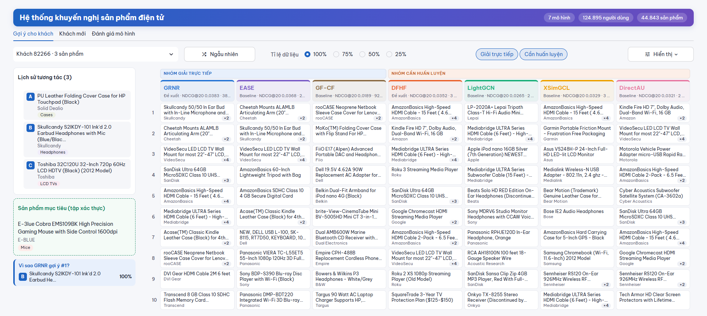

# Hệ thống khuyến nghị sản phẩm điện tử bằng hồi quy lân cận và khuếch tán trên đồ thị

**Tiếng Việt** · [English](README.en.md) · [Báo cáo đầy đủ (PDF)](report/main.pdf)

Dự án Học máy nâng cao xây dựng hai mô hình khuyến nghị top-K từ lịch sử tương tác và đánh giá chúng trên Amazon Electronics. Nghiên cứu xem xét sự đánh đổi giữa chất lượng xếp hạng, dung lượng mô hình và lượng dữ liệu huấn luyện.

- **GRNR** đạt NDCG@20 **0,03829** khi giữ toàn bộ dữ liệu huấn luyện, với checkpoint **40,5 MiB**. Chênh lệch so với EASE đầy đủ là +0,00033, với khoảng tin cậy 95% từ −0,00007 đến +0,00073.
- **DFHF** có NDCG@20 cao nhất trong nhóm mô hình huấn luyện lặp ở cả bốn mức dữ liệu. Khi chỉ giữ 25%, DFHF đạt **0,01766**, thấp hơn nhẹ so với mốc xếp hạng theo độ phổ biến **MostPop** (0,01771).

## Chạy demo

Từ thư mục gốc của repo, tạo môi trường Python 3.11 và chạy Streamlit. Bản clone đã có dữ liệu xử lý và checkpoint để thử gợi ý.

```bash
conda create -n aml-recsys python=3.11
conda activate aml-recsys
python -m pip install -r requirements.txt
python -m streamlit run app/streamlit_app.py
```

- **Gợi ý cho khách** hiển thị top-10 cho người dùng có sẵn và đóng góp của từng sản phẩm trong lịch sử vào điểm gợi ý của GRNR.
- **Khách mới** cho phép tạo lịch sử từ các sản phẩm trong danh mục rồi thử GRNR, DFHF, EASE top-128 và GF-CF.
- **Đánh giá mô hình** trình bày hai nhóm so sánh. Trên bản clone mới, thẻ này báo thiếu bảng tổng hợp cho đến khi có tệp kết quả thực nghiệm.



## Hai mô hình đề xuất

| Mô hình | Cách tính điểm | Đối chứng |
| --- | --- | --- |
| **GRNR** · Graph-Regularized Neighborhood Regression | Hồi quy có điều chuẩn đồ thị trên tối đa 128 sản phẩm lân cận cho mỗi sản phẩm đích. Hệ phương trình được giải trực tiếp bằng Cholesky. | EASE đầy đủ, EASE top-128, GF-CF |
| **DFHF** · Diffusion-Filtered History Factorization | Tổng hợp véc-tơ sản phẩm trong lịch sử sau khi lọc khuếch tán. Mô hình dùng Adam và softmax trên danh mục, với sản phẩm đích được giữ lại làm nhãn huấn luyện. | LightGCN, XSimGCL, DirectAU |

Cả hai mô hình có thể chấm điểm từ một lịch sử tương tác mới mà không cần học thêm véc-tơ riêng cho người dùng. Xem [sơ đồ GRNR](report/image/grnr_diagram.png) và [sơ đồ DFHF](report/image/dfhf_diagram.png).

## Dữ liệu và giao thức đánh giá

Thực nghiệm dùng bản 5-core của Amazon Electronics. Đánh giá từ 4 sao trở lên được quy đổi thành phản hồi tích cực. Dữ liệu sau tiền xử lý có **124.895 người dùng**, **44.843 sản phẩm** và **858.192 tương tác huấn luyện**. [Nguồn dữ liệu Amazon Product Data](https://cseweb.ucsd.edu/~jmcauley/datasets/amazon/links.html) · [Manifest dữ liệu](data/manifest.json)

- **Chia dữ liệu theo thời gian.** Với mỗi người dùng được chọn để đánh giá, tương tác áp cuối vào tập xác thực (validation) và tương tác cuối vào tập kiểm tra (test). Tỉ lệ 80/10/10 được tính trên toàn bộ tương tác.
- **Giảm dữ liệu huấn luyện.** Mọi mô hình dùng chung các tập giữ lại 25%, 50%, 75% hoặc 100% tương tác huấn luyện. Việc lấy mẫu dùng seed 42 và giữ ít nhất một tương tác cho mỗi người dùng và sản phẩm có trong tập huấn luyện gốc.
- **Xếp hạng top-K.** Các mô hình được đánh giá trên cùng 107.215 người dùng có lịch sử và sản phẩm đích đã xuất hiện trong tập huấn luyện. Bộ đánh giá xếp hạng toàn bộ sản phẩm ứng viên trong tập huấn luyện, loại các mục trong lịch sử huấn luyện gốc và báo cáo NDCG, Recall ở K = 10 và 20, cùng MRR@20.

## Kết quả thực nghiệm

Các bảng dưới đây ghi **NDCG@20 trên tập xác thực**. Mỗi cột là tỉ lệ tương tác huấn luyện được giữ lại.

### Nhóm giải trực tiếp

| Mô hình | 25% | 50% | 75% | 100% |
| --- | ---: | ---: | ---: | ---: |
| **GRNR** | **0,00798** | 0,01715 | 0,02928 | **0,03829** |
| EASE đầy đủ | 0,00674 | **0,01917** | **0,02939** | 0,03796 |
| EASE top-128 | 0,00497 | 0,01766 | 0,02772 | 0,03679 |
| GF-CF | 0,00385 | 0,00384 | 0,00839 | 0,01886 |

GRNR cao hơn EASE top-128 ở ba trong bốn mức và thấp hơn cả hai bản EASE ở mức 50%. Ở mức 100%, GRNR mất khoảng 2,5 phút để khớp mô hình trên CPU. Ma trận trọng số float32 của EASE đầy đủ ước tính chiếm 7,49 GiB, so với checkpoint 40,5 MiB của GRNR. [Biểu đồ nhóm giải trực tiếp và MostPop](report/image/H9_mostpop_closed_ndcg20.png)

### Nhóm huấn luyện lặp

| Mô hình | 25% | 50% | 75% | 100% |
| --- | ---: | ---: | ---: | ---: |
| **DFHF** | **0,01766** | **0,02266** | **0,02901** | **0,03519** |
| LightGCN | 0,00842 | 0,01839 | 0,02261 | 0,02655 |
| XSimGCL | 0,01117 | 0,01933 | 0,02759 | 0,03292 |
| DirectAU | 0,01029 | 0,02050 | 0,02698 | 0,03205 |

Ở mức 25%, MostPop đạt 0,01771. Chênh lệch nhỏ giữa DFHF và MostPop chưa được kiểm định. Với lịch sử chỉ có một tương tác, DFHF xếp hạng bằng hệ số chặn đã học của từng sản phẩm. [Biểu đồ nhóm huấn luyện lặp và MostPop](report/image/H9_mostpop_trained_ndcg20.png)

Các phép so sánh trong từng nhóm mang tính khám phá, dùng bootstrap ghép cặp theo người dùng với 10.000 lần lấy mẫu lại và hiệu chỉnh Holm. Kết quả đến từ một bộ dữ liệu, một seed và tập xác thực đã dùng để chọn checkpoint cho các mô hình huấn luyện lặp. Ngân sách tinh chỉnh chưa đồng đều và thời gian chạy được đo trên các phần cứng khác nhau. [Giao thức và kết quả chi tiết, Chương 4–6](report/main.pdf)

## Tái tạo thực nghiệm

**Khớp một mô hình GRNR trên CPU** và ghi kết quả vào thư mục riêng. Dữ liệu đã xử lý đi kèm repo. Khi cần dựng lại dữ liệu từ nguồn, chạy `python scripts/prepare_data.py`. Script tải dữ liệu theo [cấu hình chung](configs/common.yaml).

```bash
python scripts/train_model.py --model grnr --density 1.0 --seed 42 --device cpu --results results/reproduction
```

Thay `--model` bằng `dfhf`, `lightgcn`, `xsimgcl`, `directau`, `ease` hoặc `gfcf` và chọn `--density` từ `0.25`, `0.5`, `0.75`, `1.0`. Chạy lại mỗi mô hình ở cả bốn mức để tái tạo hai nhóm so sánh. DFHF và ba đối chứng huấn luyện lặp dùng 200 epoch, giữ checkpoint có NDCG@20 cao nhất trên tập xác thực. Các lần chạy gốc dùng [notebook GPU](kaggle/kaggle_train.ipynb) cho nhóm này và [notebook CPU](kaggle/kaggle_ease.ipynb) cho EASE đầy đủ do yêu cầu bộ nhớ của ma trận dày.

Sau khi có kết quả ở cả bốn mức, chạy các lệnh sau để tạo bảng tổng hợp, bảng và hình cho nhóm giải trực tiếp, cùng các hình cho nhóm huấn luyện lặp.

```bash
python scripts/summarize_results.py --results results/reproduction
python scripts/make_closed_form_report.py --results results/reproduction --output results/reproduction/closed-form
python scripts/make_trained_group_report.py --results results/reproduction --output results/reproduction/trained
```

**Tệp đi kèm repo.** Git lưu dữ liệu đã xử lý, checkpoint, lịch sử huấn luyện và hình báo cáo. `metrics.json`, `val_predictions.npy`, `val_users.npy` và các bảng CSV thực nghiệm được tạo khi chạy pipeline. Để bật đầy đủ thẻ đánh giá trong demo, đặt `summary.csv` và các tệp kết quả theo từng lần chạy vào cây `results/` mặc định của ứng dụng, rồi chép bảng B5/B6 vào `reports/tables/`. Các checkpoint lịch sử nằm trong `results/sgkr/` và `results/sphr/`, tương ứng với GRNR và DFHF.

## Cấu trúc repo

| Đường dẫn | Nội dung |
| --- | --- |
| [`src/`](src/) · [`configs/`](configs/) | Mô hình, xử lý dữ liệu, đánh giá và cấu hình thực nghiệm |
| [`scripts/`](scripts/) · [`kaggle/`](kaggle/) | Lệnh huấn luyện, tổng hợp kết quả và notebook |
| [`app/`](app/) | Demo Streamlit |
| [`data/`](data/) · [`results/`](results/) | Dữ liệu đã xử lý và checkpoint |
| [`report/`](report/) · [`reports/figures/`](reports/figures/) | Báo cáo PDF, hình minh họa và hình thực nghiệm |

## Tài liệu tham khảo

- **Dữ liệu.** McAuley và cộng sự, SIGIR 2015. [Image-Based Recommendations on Styles and Substitutes](https://arxiv.org/abs/1506.04757). He và McAuley, WWW 2016. [Ups and Downs](https://arxiv.org/abs/1602.01585).
- **Đối chứng giải trực tiếp.** Steck, WWW 2019. [EASE](https://arxiv.org/abs/1905.03375). Shen và cộng sự, CIKM 2021. [GF-CF](https://arxiv.org/abs/2108.07567).
- **Đối chứng huấn luyện lặp.** He và cộng sự, SIGIR 2020. [LightGCN](https://arxiv.org/abs/2002.02126). Yu và cộng sự, IEEE TKDE. [XSimGCL](https://arxiv.org/abs/2209.02544). Wang và cộng sự, KDD 2022. [DirectAU](https://arxiv.org/abs/2206.12811).
- **Biên tập README.** Kassis, Agarwal, He, Patel và Brueckner (2026). [Scientific Agent Skills](https://arxiv.org/abs/2609.00065).
